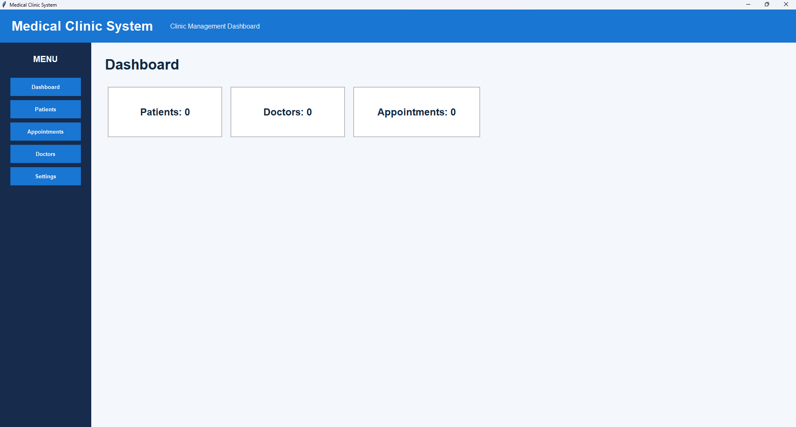
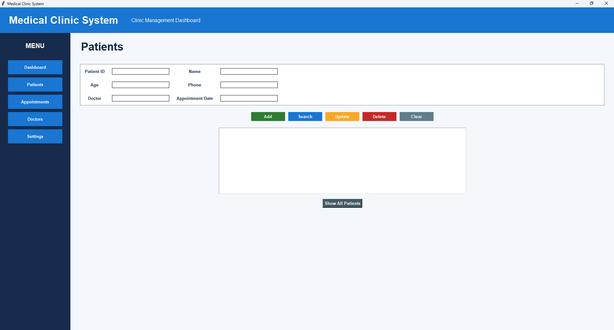
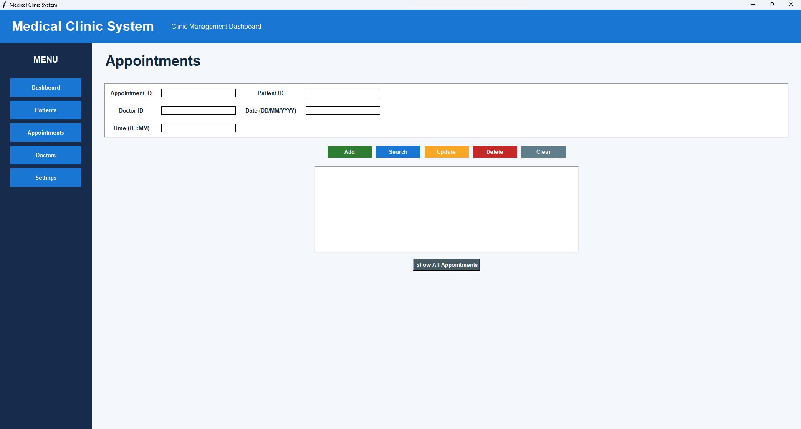
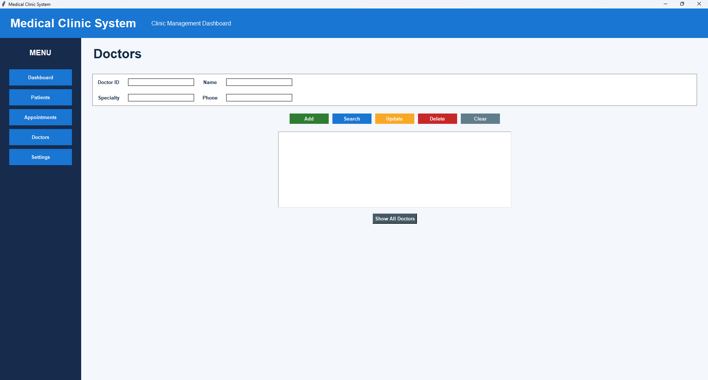
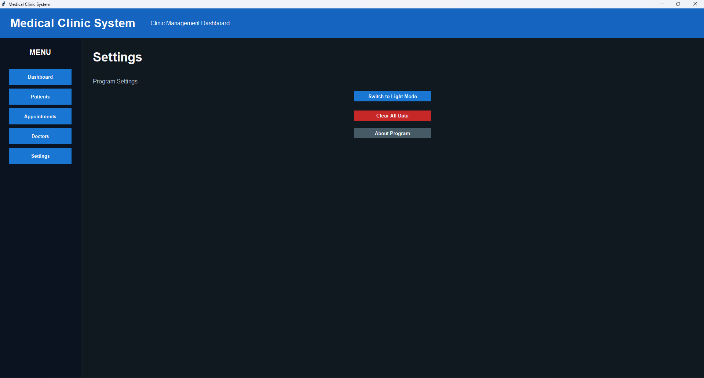

# Medical Clinic System

A desktop-based Medical Clinic Management System
built using Python and Tkinter.

## Dashboard
The main dashboard displays:
- Total Patients
- Total Doctors
- Total Appointments

## Main Sections
- Dashboard
- Patients
- Appointments
- Doctors
- Settings

## Technologies
- Python
- Tkinter

## Project Structure
- main.py
- backend.py
   
## Screenshots

### Dashboard

### Patients

### Appointments

### Doctors

### Settings - Dark Mode

